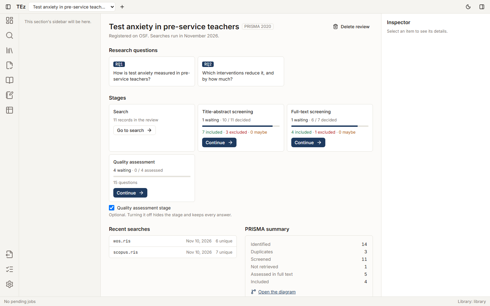
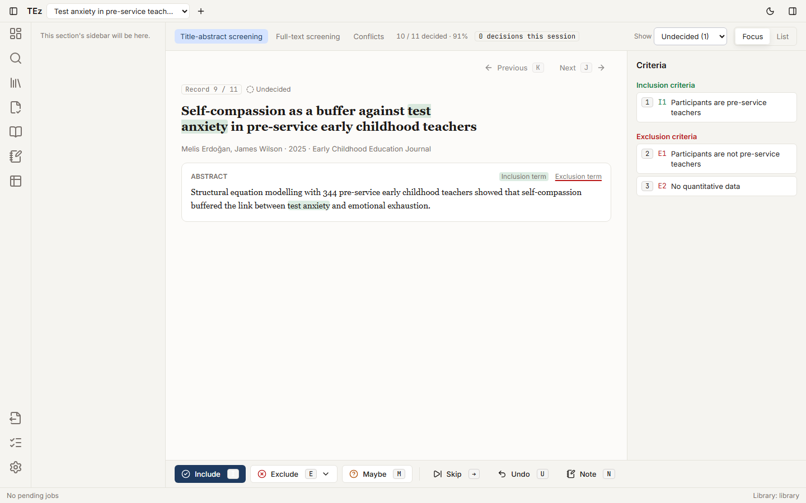
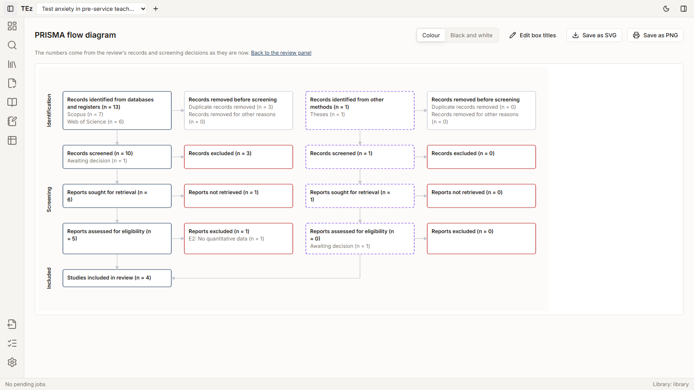
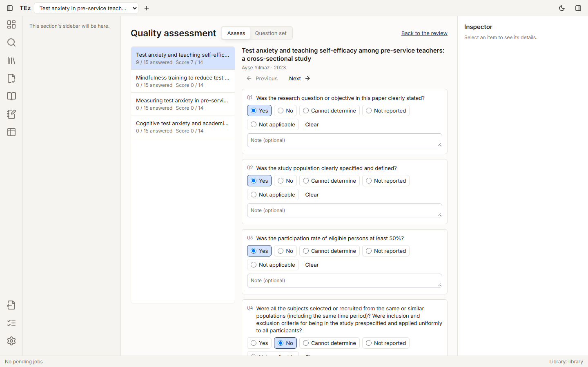
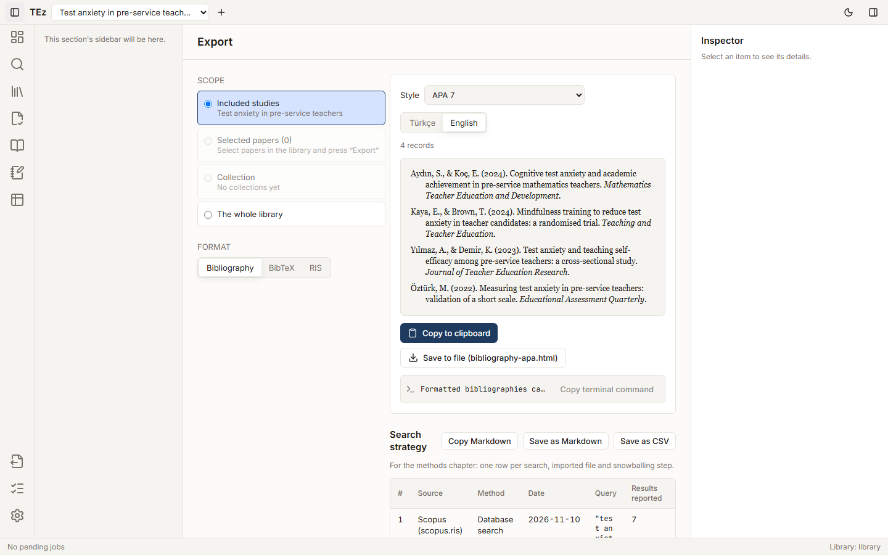
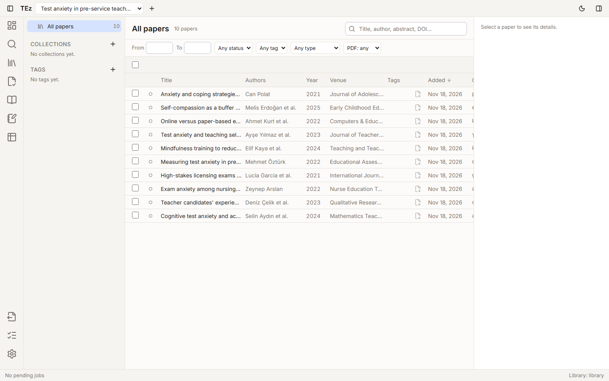
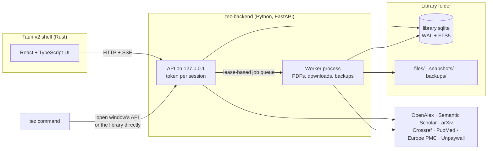

<div align="center">

# TEz

**A local-first workbench for systematic literature reviews, from the first search to the bibliography of your thesis.**

[](https://github.com/Adoocat/TEz/actions/workflows/ci.yml)
[](LICENSE)


[What it does](#what-it-does) · [Getting started](#getting-started) · [Architecture](#architecture) · [Development](#development) · [Roadmap](#roadmap) · [Docs](#documentation)

</div>

---

TEz ("thesis" in Turkish) helps graduate students and researchers in **every discipline** run a systematic review the way their methods chapter will describe it: search several databases at once, screen hundreds of records with the keyboard, keep the reason for every decision, and get the **PRISMA 2020** flow diagram and a formatted bibliography straight from that record.

Everything lives in a folder on your own computer. The only network traffic goes to public academic sources.

<sub>Screenshots show a fictional demo review; the records in them are made up.</sub>

<p align="center">
  
</p>

> **Status:** Phases 1 (library and search) and 2 (systematic review: screening, PRISMA, snowballing, quality assessment, bibliographies, two reviewers) are complete. Phase 3 (full text, notes and the literature matrix) is next. See the [roadmap](#roadmap).

## Contents

- [What it does](#what-it-does)
- [Principles](#principles)
- [Getting started](#getting-started)
- [Your first review in fifteen minutes](#your-first-review-in-fifteen-minutes)
- [Keyboard shortcuts](#keyboard-shortcuts)
- [The `tez` command](#the-tez-command)
- [Architecture](#architecture)
- [Development](#development)
- [Project layout](#project-layout)
- [Roadmap](#roadmap)
- [Documentation](#documentation)
- [License](#license)

## What it does

TEz follows a review from start to finish:

```text
 Search ──► Screen (title/abstract) ──► Screen (full text) ──► Read & extract ──► Report
   │              │                           │                     │                 │
 6 APIs +     keyboard-first,            PDF beside the       highlights, notes,  PRISMA 2020,
 file imports criteria & reasons         decision bar         a matrix whose      bibliography,
 deduplicated append-only decisions      "not retrieved"      cells cite the PDF  matrix export
```

### Search and import

- **Federated search** across **OpenAlex, Semantic Scholar, arXiv, Crossref, PubMed and Europe PMC** at once. Each source gets the query translated into its own syntax, shows its live state (searching, rate-limited, partial, failed), and keeps its raw response for reproducibility.
- **Deduplication:** identifiers first (DOI, arXiv, PMID/PMCID, ISBN), then fuzzy title with year and first-author checks. A preprint and its published version are linked, not merged.
- **Databases without an open API** come in through their exports (BibTeX, RIS) and count in PRISMA like any other source. **Import presets** know each database's quirks and are switched on only after a real export has been tested: **Google Scholar** and **TR Dizin** today; Scopus, Web of Science, JSTOR, EBSCO, ProQuest, PsycInfo, IEEE Xplore and ACM DL as soon as their samples arrive.
- **Saved external searches:** store the query of a database you search on its website, open the site with the query copied, and on the next import see only what is new since the last one.
- **Publication types** for books, chapters and theses (master's or doctoral), with a theses-only search.

### Screening

<p align="center">
  
</p>

- **A focus mode built for hundreds of records:** one record at a time, title and abstract in a readable serif, your highlight terms marked in the abstract (Turkish-aware), criteria on the side.
- **Two stages:** title/abstract, then full text with the PDF beside the decision bar. "Full text not retrieved" is a decision of its own and has its own PRISMA box.
- **Criteria with codes** (`I1`, `E1`, `E2` …) and number keys. An exclusion always records its reason.
- **Append-only decisions:** a correction or an undo is a new row, so the whole history stays auditable.
- **Two reviewers:** each person screens in their own library, decisions move between libraries as a versioned JSON file, conflicts are shown side by side, and **Cohen's kappa** and percent agreement are reported per stage.

### Other methods, appraisal and reporting

<p align="center">
  
</p>

- **Snowballing:** backward (references) and forward (citing papers) from your included studies, in numbered rounds (Wohlin), through OpenAlex and Semantic Scholar.
- **Grey literature:** theses, reports, registers and web pages added by hand or marked on import, counted in PRISMA's "other methods" branch.
- **PRISMA 2020 flow diagram:** every number derived from the records on each read and never stored. Editable box titles, a black-and-white print theme, SVG and PNG export.
- **Quality assessment:** optional and discipline-neutral. Use your own questions and scales, or start from a bundled checklist (the public-domain NHLBI tools); scores are derived.
- **Formatted bibliographies** with CSL (`citeproc-py`): APA 7, MLA 9, Chicago 18, Vancouver and IEEE, in Turkish or English, for the included studies, a collection or a selection. Copy to the clipboard or save to a file.
- **Search strategy table** for the methods chapter: every search, import and snowballing step with its date, exact query and counts, as Markdown or CSV.
- **BibTeX and RIS export**, with stable citation keys like `yilmaz2024automated`.

<table>
  <tr>
    <td width="50%"></td>
    <td width="50%"></td>
  </tr>
  <tr>
    <td align="center"><sub>Quality assessment with a bundled checklist</sub></td>
    <td align="center"><sub>APA 7 bibliography and the search strategy table</sub></td>
  </tr>
</table>

### Library and reading

<p align="center">
  
</p>

- **Collections** (a tree; a paper can sit in several), coloured **tags**, reading status, and a trash.
- **A virtualised table** that stays smooth with 2,000+ papers, with sorting, filters and full-text search over metadata that folds Turkish correctly (`isik` finds "Işık").
- **PDFs** dropped on the window are stored once by hash and inspected in a separate worker process, so a broken file cannot crash the app. Free copies are fetched from arXiv and Unpaywall in the background.
- **A reader** built on pdf.js that streams byte ranges, draws only the pages near the screen, and links to a page (`#/reader/<id>?page=12`).
- **Backups** as one zip with checksums; restore is verified before the library opens.
- **Reviews** can be moved to the trash and restored; what was recorded under them is never lost.

### Reading, notes and the matrix

Everything taken from a PDF stays tied to the place it came from: a quote with its page, the text before and after it, and its position. Each item can open the PDF at that sentence, and if a new version of the file moves the passage, TEz finds it again or marks it as lost rather than pointing at the wrong place.

- **Full-text search.** PDFs are read page by page in the worker, so you can search their text. A hit opens the right page. Broken, encrypted and scanned files are flagged instead of stopping the queue.
- **The reader** has in-document search, the outline, page thumbnails, tabs for several documents and a focus mode, and stays smooth at 300 pages.
- **Highlights** come in colours, with comments, and can also cover an area such as a figure (`H`).
- **Notes** are Markdown with `[[links]]` to papers and other notes, and show backlinks. They save as you type. **Quote to note** (`⇧N`) adds a source chip that reopens the reader at that sentence.
- **The literature matrix** has a row for every study included at full text and typed columns (text, number, choice, several choices, yes/no). You edit it from the keyboard and can undo. A type change never drops a value it cannot convert.
- **Cell evidence.** **Link to a matrix cell** backs a cell with a sentence of the PDF. The matrix shows how much of it rests on passages. You can export it to Excel, CSV or Markdown, with the passages and their pages.
- **Figure and table gallery:** areas cut from the reader, kept with their source. You can compare two to four side by side and export them to one HTML file.
- **GROBID (optional).** With a GROBID running on this computer, the reader lists a paper's sections and references and marks the references already in your library. Without it, nothing of it shows.

## Principles

| | |
| --- | --- |
| **Local-first** | Your library (database, PDFs, snapshots, backups) is a folder on your machine. The network is used only for OpenAlex, Semantic Scholar, arXiv, Crossref, PubMed, Europe PMC and Unpaywall. API keys live in the operating system's keychain. |
| **Traceable** | Searches, results and screening decisions are append-only records. Every number in PRISMA is derived from them, never typed in or stored. Each search keeps its exact query and raw response. |
| **For every field** | Nothing assumes computer science: PRISMA 2020 is the default method, and sources, presets and checklists cover health, education, social sciences, law and the humanities as well. |
| **Robust** | A broken PDF, a failing source or a malformed export is caught, logged and flagged; the rest keeps working. |
| **Open** | MIT-licensed, with no GPL or AGPL dependencies (pypdfium2 instead of PyMuPDF, citeproc-py instead of citeproc-js). |

## Getting started

### Requirements

| Tool | Version | Used for |
| --- | --- | --- |
| [uv](https://docs.astral.sh/uv/) | latest | Python 3.12+ and the backend's dependencies |
| [Node.js](https://nodejs.org/) | 24+ | the web UI and the helper scripts |
| [pnpm](https://pnpm.io/) | 12 | JavaScript packages (`corepack enable` installs it) |
| [Rust](https://rustup.rs/) | stable (MSVC on Windows) | only for the desktop app |
| Visual Studio Build Tools + WebView2 | | only for the desktop app on Windows |

No `make` or bash is needed: every helper script is Node or Python.

### Install and run

```bash
git clone https://github.com/Adoocat/TEz.git
cd TEz
pnpm bootstrap      # Python and Node dependencies, plus the git hooks
pnpm dev            # backend on http://127.0.0.1:8787 + UI on http://localhost:1420
```

Open **http://localhost:1420** once the terminal shows `Application startup complete`. `pnpm dev` uses a development library in `backend/.dev/TEz Library` (git-ignored, created on first run), so you can try anything without touching real data. Stop it with `Ctrl+C`.

For the desktop app instead of the browser (the first build takes a few minutes):

```bash
pnpm dev:desktop
```

To try TEz with data, make a demo library of fictional papers. `--review` adds a demo review that has already been searched, screened and tabulated:

```bash
uv run --project backend python -m tez.devtools.demo <empty-folder> --papers 2000 --review
uv run --project backend tez-backend serve --library <empty-folder>
```

The second command prints a local address with a token; open it in your browser.

The demo review, *LLM assistants in code review*, has:
- two database searches (Scopus and IEEE Xplore, one record found by both);
- title-abstract and full-text decisions with their reasons, and one report not retrieved;
- generated PDFs for the reports;
- a data extraction matrix whose findings are each linked to a sentence in the PDF.

Its PRISMA diagram, matrix and exports are ready to look at. Every name and DOI in it is made up.

## Your first review in fifteen minutes

1. **Create a review.** Click **+** in the title bar, give it a title and a research question. The method defaults to PRISMA 2020.
2. **Write your criteria.** In the review panel, add an inclusion criterion (`I1`) and a few exclusion reasons (`E1`, `E2`). Add highlight terms to have them marked in abstracts.
3. **Search.** Open **Search**, type a query such as `"test anxiety" AND teachers`, and run it on all sources. Filter the results and send the ones you want to the review with **Add to review**. Exports from other databases come in through **Import file**.
4. **Screen titles and abstracts.** Open **Screening** and decide with the keyboard: `I` include, `E` then a number to exclude with a reason, `M` maybe, `→` skip, `U` undo.
5. **Screen full texts.** Switch to the **Full text** tab. Use **Find PDFs** for free copies, read them beside the decision bar, or mark a report as not retrieved.
6. **Look at PRISMA.** In the review panel, **Open the diagram**. Rename boxes if your journal wants different wording, switch to black and white, save as SVG or PNG.
7. **Appraise (optional).** Turn on quality assessment, pick a checklist or write your own, and score each included study.
8. **Read and extract.** Open an included study in the reader, highlight what matters, and in **Matrix** create a matrix with a column for each thing you extract (method, sample, finding…). Select a sentence and choose **Link to a matrix cell**: the cell gets the sentence, and the sentence stays one click away.
9. **Write it up.** Open **Export**: copy the bibliography of the included studies in your style and language, and save the search strategy table for your methods chapter. Export the matrix from **Matrix** as Excel, CSV or Markdown.

## Keyboard shortcuts

| Where | Keys | Action |
| --- | --- | --- |
| Anywhere | `?` | Show every shortcut |
| Screening | `I` · `E` + `1`–`9` · `M` | Include · exclude with reason · maybe |
| Screening | `→` · `U` · `N` | Skip · undo · note |
| Screening | `J` · `K` | Next · previous record, without deciding |
| Screening | `1`–`9` | The criterion with that number |
| Reader | `J` · `K` · `Ctrl+F` · `F` | Next · previous page · find in the document · focus mode |
| Reader | `H` · `⇧N` | Highlight the selection · quote it to a note |

Every shortcut is also a visible button; the `?` overlay is generated from the same map, so it is always complete.

## The `tez` command

The same features from a terminal, for scripts or for running a search while the window is open:

```bash
tez search '"test anxiety" AND teachers' --sources oa,pm,epmc --review "My review"
tez import scopus.ris --source Scopus --searched-at 2026-11-01 --query '"test anxiety"'
tez add papers/ --collection Thesis
tez export --format bibtex --review "My review" -o refs.bib
```

| Option | Meaning |
| --- | --- |
| `--library <folder>` | Library to use (default: `TEZ_LIBRARY`, or `Documents/TEz Library`) |
| `--sources` | `openalex` (`oa`), `semantic_scholar` (`s2`), `arxiv`, `crossref` (`cr`), `pubmed` (`pm`), `europepmc` (`epmc`) |
| `--json` | Stable JSON output for scripts (English field names) |
| `--lang tr\|en` | Output language (default: system language) |
| `--quiet` | Errors only |

If the library is open in a window, commands go through that window's API and their results appear there at once; otherwise the command opens the library itself. Exit codes: `0` done, `1` failed, `2` partly done. In development, run it as `uv run --project backend tez …`. In Windows PowerShell 5.1, piping its output needs `[Console]::OutputEncoding = [Text.Encoding]::UTF8` first.

## Architecture



- **One backend binary, three modes:** `serve` (the API), `worker` (jobs) and `cli` (headless commands). The Tauri shell starts the API as a sidecar on a random port with a fresh token; the API supervises the worker and restarts it if it dies.
- **Crash isolation:** native code that reads PDFs runs only in the worker, so a hostile file can take down the worker but never the window. A job whose lease runs out is retried; a file that keeps failing is marked and skipped.
- **Typed end to end:** the TypeScript client is generated from the backend's OpenAPI schema, and CI fails if it is stale.
- **Browser mode:** the same backend runs without the shell (`tez-backend serve`), which is how `pnpm dev` and the end-to-end tests work.

Start with [`docs/architecture.md`](docs/architecture.md), then the decisions in [`docs/adr/`](docs/adr/).

| Layer | Stack |
| --- | --- |
| Backend | Python 3.12+, FastAPI, Pydantic v2, SQLAlchemy 2, Alembic, SQLite (WAL, FTS5), httpx + hishel + tenacity, rapidfuzz, bibtexparser, rispy, pypdfium2, citeproc-py, keyring, Typer |
| Frontend | React, TypeScript (strict), Vite, react-router, TanStack Query / Table / Virtual, Zustand, react-i18next, Tailwind CSS, Radix UI, pdf.js, openapi-fetch |
| Desktop | Tauri v2 with single-instance, deep-link, shell and dialog plugins; the backend bundled with PyInstaller |
| Quality | pytest (+ xdist, recorded HTTP cassettes), ruff, pyright (strict), Vitest + Testing Library, Playwright, ESLint, Prettier, cargo clippy |

## Development

```text
pnpm bootstrap     install Python and Node dependencies and the git hooks
pnpm dev           backend (http://127.0.0.1:8787) + web UI (http://localhost:1420)
pnpm dev:desktop   the web UI inside the Tauri desktop shell
pnpm check         lint, type check and tests for Python, TypeScript and Rust (as in CI)
pnpm check py web  only some groups: py, api, web, rust, format
pnpm e2e           end-to-end tests (Playwright) against a real backend and a temporary library
pnpm gen:api       regenerate the typed API client after changing the backend's API
pnpm gen:tokens    regenerate the CSS variables after changing docs/design/tokens.json
pnpm format        apply Prettier and ruff formatting
```

- **`pnpm check`** runs the groups side by side and the backend tests on every core; only failing steps print their output. The first `pnpm e2e` needs a browser: `pnpm --filter @tez/web exec playwright install chromium`.
- **Tests never go online.** External services sit behind adapters; tests use fakes or recorded responses.
- **API access in development:** every request needs `Authorization: Bearer <token>`; `pnpm dev` prints one at start-up, and the API docs at `http://127.0.0.1:8787/docs` open without it in dev mode.
- **Settings** come from `TEZ_*` environment variables (`TEZ_LOG_LEVEL`, `TEZ_LOG_FORMAT=json|console`, `TEZ_CORS_ORIGINS`, `TEZ_LIBRARY`).
- **Migrations:** the app migrates each library itself on start-up, after copying the database to `backups/`. From `backend/`, `uv run alembic upgrade head` updates the development database and `uv run alembic revision --autogenerate --rev-id <NNNN> -m "..."` starts a new migration. See [ADR 0003](docs/adr/0003-database-layer.md).
- **Backups:** `uv run --project backend tez-backend restore <TEz-backup-….zip> <new folder>` restores into a new folder, checked against its checksums.

### Conventions

- Code, comments, commits, README and ADRs in English; the UI in Turkish and English, always both (`apps/web/locales/`).
- [Conventional Commits](https://www.conventionalcommits.org/); one task = one branch (`task/<no>-<name>`) = one pull request.
- Backend modules follow `modules/<name>/{router,service,repository,schemas,models}.py`; modules talk to each other's services, never their repositories.
- Errors are codes (`TezError(code, params)`); the UI turns them into sentences.
- Any deviation from the plan is recorded as an ADR in [`docs/adr/`](docs/adr/).

## Project layout

```text
TEz/
├─ apps/
│  ├─ web/                 React UI: src/features/<screen>/ slices, locales/ (tr, en), e2e/ (Playwright)
│  └─ desktop/             Tauri v2 shell (Rust): sidecar start-up, single instance, open requests
├─ backend/
│  ├─ src/tez/
│  │  ├─ core/             configuration, database, errors, auth, logging
│  │  ├─ shared/           outbound HTTP, identifiers, Turkish-safe text folding
│  │  ├─ modules/          library, search (+ providers/), importers, files, reviews, screening,
│  │  │                    prisma, snowballing, greylit, quality, export, dual_screening, jobs,
│  │  │                    fulltext, anchors, annotations, notes, matrix, assets, structure, …
│  │  ├─ migrations/       Alembic migrations, applied by the app itself
│  │  ├─ devtools/         the demo library and demo review
│  │  └─ cli/              the tez command
│  └─ tests/               unit and integration tests, fixtures, recorded cassettes
├─ docs/                   plan, architecture, ADRs, design system, progress, licenses
└─ scripts/                Node scripts behind the pnpm commands
```

## Roadmap

| Phase | Scope | Status |
| --- | --- | --- |
| **1** | Library, federated search, deduplication, BibTeX/RIS import and export, PDFs, reader, backups, `tez` command | ✅ Done |
| **2** | Review wizard, criteria, two-stage screening, PRISMA 2020, snowballing, grey literature, quality assessment, CSL bibliographies, export screen, two reviewers, PubMed and Europe PMC, import presets | ✅ Done |
| **3** | Full-text extraction and search, highlights, notes with backlinks, the literature matrix with evidence linked to PDF passages, figure and table gallery, optional GROBID | ✅ Done |
| **4** | Saved-search alerts, refresh reminders for external searches, citation graph | ⏳ Next |
| **5** | Optional AI assistance whose every claim is checked against a verified quote in the source | Planned |
| **6** | Installers for Windows, macOS and Linux, `tez` on the PATH, "Open with TEz", Zotero export | Planned |

New API sources come one at a time, each with its own decision record: DOAJ, ERIC and CORE, then DergiPark.

## Documentation

| Document | What is in it |
| --- | --- |
| [`docs/architecture.md`](docs/architecture.md) | How the pieces fit together; read this first |
| [`docs/plan.md`](docs/plan.md) | The plan, data model and task list for every phase (in Turkish) |
| [`docs/adr/`](docs/adr/) | Architecture decision records: what was decided and why |
| [`docs/progress.md`](docs/progress.md) | Task status, open questions and the "later" list (in Turkish) |
| [`docs/design/`](docs/design/) | Design system, tokens and screen mock-ups |
| [`docs/formats/`](docs/formats/) | File formats TEz writes, such as screening decisions for a second reviewer |
| [`docs/licenses.md`](docs/licenses.md) | Third-party licenses, including the bundled CSL styles and checklists |

## License

[MIT](LICENSE) © 2026 Demirkan Doğru. Third-party licenses are listed in [`docs/licenses.md`](docs/licenses.md).
